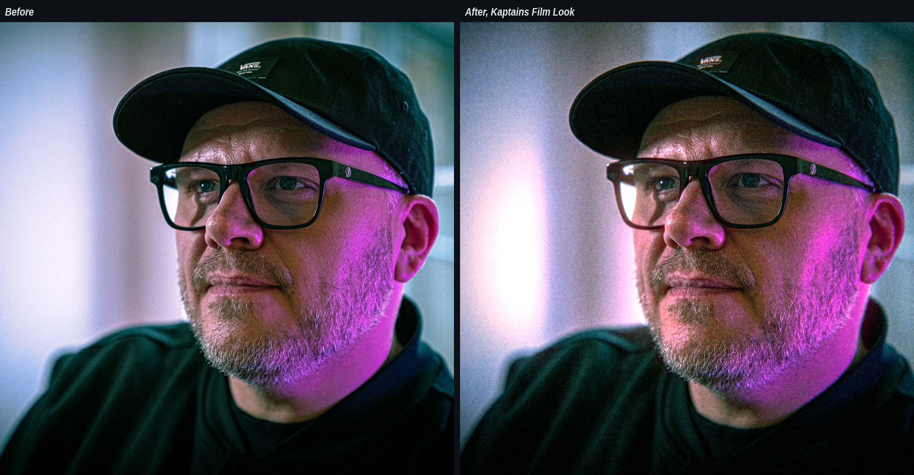

# Kaptains Film Look

A free plug-in for After Effects and Premiere Pro that makes digital footage look like it was shot through a real lens on film. Made by Henrik Jonas Kaptain, video editor and promo producer (kaptainen.dk).

## What it does
One effect, seven steps, always applied in this order.

1. Lens distortion. Bends the image like a real lens.
2. Chromatic aberration. Colour fringes towards the edges, with its own blur.
3. Lens blur. Soft, radial, swirl or directional (with angle).
4. Vignette. Darker corners.
5. Bloom. Highlights glow, with blur and stretch.
6. Halation. The red glow around bright areas you get on film, with blur and stretch.
7. Grain. Film grain.

## Zones
Every step has its own zone, so you decide where it hits. Start is where the effect begins to fade in, Full is where it is at full strength. All steps share one movable centre and one shape, from oval to circle. Show Zones draws the rings on top of the picture while you work.

The look is calculated from the size of the image, so it looks the same in HD, 4K, vertical and square.

## Requirements
Mac with Apple silicon (M1 or newer). After Effects or Premiere Pro. Intel Macs and Windows are not supported yet.

After Effects renders on the GPU. Premiere Pro renders on the CPU for now, so heavy settings are slower there.

## Download and install
1. Download the newest zip under Releases.
2. Unzip it and keep the three items together.
3. Right-click Install Kaptains Film Look.command and choose Open. The plug-in is not notarized by Apple, so macOS asks the first time.
4. Type your Mac password and restart After Effects or Premiere Pro.

Full details are in READ ME FIRST.txt in the zip.

## Where to find it
After Effects. Effect, Kaptain, Kaptains Film Look.

Premiere Pro. Effects panel, Video Effects, Kaptain, Kaptains Film Look.

Turn off Show Zones before you render in Premiere Pro, or the rings end up in the export.

## Uninstall
Delete KaptainsFilmLook.plugin from /Library/Application Support/Adobe/Common/Plug-ins/7.0/MediaCore and restart the Adobe apps.

## Status
Early version (0.1.0). Free to use. This repository holds releases only.
