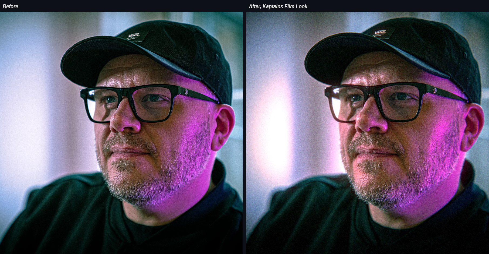

# Kaptains Film Look

A free and open source plug-in for After Effects and Premiere Pro that makes digital footage look like it was shot through a real lens on film. Made by Henrik Jonas Kaptain, video editor and promo producer (kaptainen.dk).



## What it does
One effect, seven steps, always applied in this order.

1. Lens distortion. Bends the image like a real lens.
2. Chromatic aberration. Colour fringes towards the edges, with its own blur.
3. Lens blur. Soft, radial, swirl or directional (with angle).
4. Vignette. Darker corners.
5. Bloom. Highlights glow, with blur and stretch.
6. Halation. The red glow around bright areas you get on film, with blur and stretch.
7. Grain. Film grain.

## Zones
Every step has its own zone, so you decide where it hits. Start is where the effect begins to fade in, Full is where it is at full strength. All steps share one movable centre and one shape, from oval to circle. Show Zones draws the rings on top of the picture while you work.

The look is calculated from the size of the image, so it looks the same in HD, 4K, vertical and square.

## Requirements
Mac with Apple silicon (M1 or newer). After Effects or Premiere Pro. Intel Macs and Windows are not supported yet.

After Effects renders on the GPU. Premiere Pro renders on the CPU for now, so heavy settings are slower there.

## Download and install
1. Download the newest zip under Releases.
2. Unzip it and keep all the files together.
3. Right-click Install Kaptains Film Look.command and choose Open. The plug-in is not notarized by Apple, so macOS asks the first time.
4. Type your Mac password and restart After Effects or Premiere Pro.

Full details are in READ ME FIRST.txt in the zip.

## Where to find it
After Effects. Effect, Kaptain, Kaptains Film Look.

Premiere Pro. Effects panel, Video Effects, Kaptain, Kaptains Film Look.

Turn off Show Zones before you render in Premiere Pro, or the rings end up in the export.

## Uninstall
Delete KaptainsFilmLook.plugin from /Library/Application Support/Adobe/Common/Plug-ins/7.0/MediaCore and restart the Adobe apps.

## Status
Early version (0.1.0). Free to use, free to change.

## Building from source

You need a Mac with Apple silicon, Xcode (for clang, Rez and codesign) and the free Adobe SDKs. The Adobe SDKs are not part of this repository and cannot be shared here. Download them yourself from the [Adobe Developer site](https://developer.adobe.com/after-effects/) with an Adobe account.

1. Download the **After Effects SDK 27.0** and the **Premiere Pro 27.0 C++ SDK** for Mac.
2. Unpack them so the folders look like this, next to `Kode` and `Plugin`:

   ```
   Adobe SDK/unpacked/AfterEffectsSDK/Examples/Headers
   Adobe SDK/unpacked/Premiere Pro 27.0 C++ SDK/Examples/Headers
   ```

3. Build, sign (ad hoc) and install:

   ```
   cd Plugin/AE
   sh build_ae.sh       # builds /tmp/kaptainsfilmlook_build/KaptainsFilmLook.plugin
   sh install_ae.sh     # copies it to the shared Adobe MediaCore folder (asks for your password)
   ```

4. To make a release zip: raise `KF_BUILD_VERSION` in `Plugin/AE/KaptainFilm.h` and the build number in `Plugin/AE/KaptainFilmPiPL.r`, then run `sh make_release.sh`.

## Repository layout

| Folder | What it is |
| --- | --- |
| `Kode/core` | The film look itself: a host independent C++ core (`kf_core.cpp/.hpp`) and a small command line tool for tests |
| `Kode/tests` | Automated checks of the core |
| `Kode/tools` | Python tools for trying the look on your own photos, plus `presets.json` |
| `Plugin/AE` | The After Effects and Premiere Pro plug-in, the Metal GPU code, build scripts, installer and tests. `README.md` there has the history from build 8 onwards |

The core does not depend on Adobe, so it can be used as a starting point for other hosts or platforms.

### Testing the core (any Mac or Linux)

```
cd Kode
sh core/build.sh
python3 tests/run_tests.py                          # needs numpy and Pillow
KF_IMAGES=<folder> python3 tools/test_raf.py NAME   # needs rawpy and scipy, reads NAME.raf and NAME.JPG
```

On Linux three of the multi threading checks currently report tiny differences. The look itself is not affected.

## How it was made

Built by Henrik Jonas Kaptain together with Claude (Anthropic). I tested and debugged it on my own footage until it did exactly what I wanted.

## License

Copyright (C) 2026 Henrik Jonas Kaptain

Kaptains Film Look is free software under the **GNU General Public License v3.0 or later**, see [LICENSE](LICENSE). It comes with an additional permission that allows it to be built with the Adobe SDKs and run inside Adobe After Effects and Premiere Pro, see [LICENSE-EXCEPTION](LICENSE-EXCEPTION).

You are free to use, study, change and share it. If you share a changed version, it must stay open source under the same license.

Adobe, After Effects and Premiere Pro are trademarks of Adobe. This project is not affiliated with or endorsed by Adobe.
